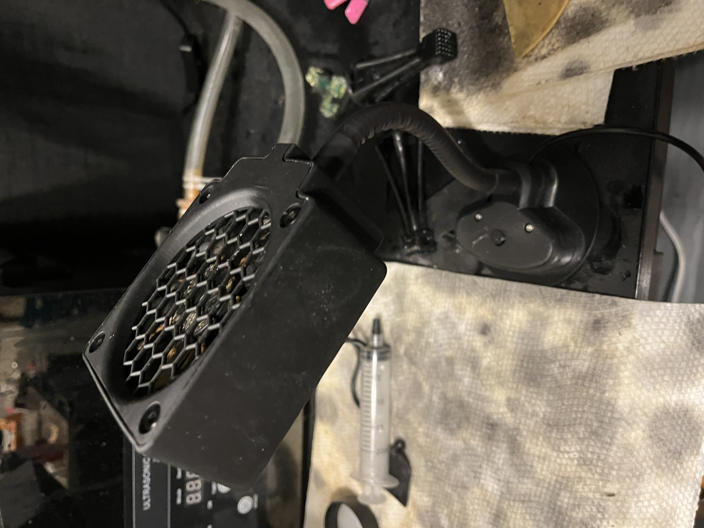
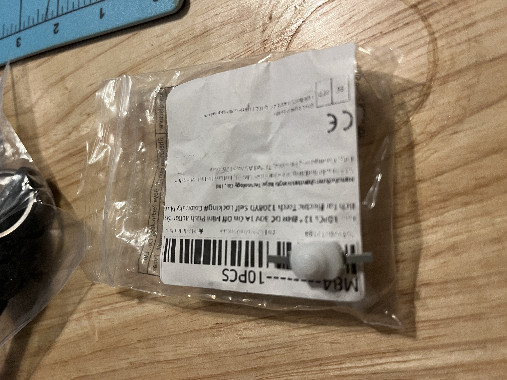

Simple body with switch for usb fan.

Use it to dry off print and tired of always running. Plus it was bad just sitting on the table.

## Required Hardware

1. 1/4 in male-male goose neck, wires routed through
2. 4x [M2x8mm screws and washers](https://www.amazon.com/dp/B0GKMVNG4D). 2 can be as long as you don't interfere with wires.
3. 4x M4*35mm [screws](https://www.amazon.com/dp/B0DYSM4T47), [washer](https://www.amazon.com/dp/B0DRJM697N) and [nuts](https://www.amazon.com/dp/B0F8GGH5GX)
4. 1x [8025 fan](https://www.amazon.com/dp/B0DFXRR3CQ)
5. 1208YD switch

## Installation instructions

### Fan Body

1. Place fan into body
2. Wire goose neck wires into place, using shrink fitting to keep neat
3. Strew goose neck into places, recommend doing the base now, allows you to put extra wire in the fan body.
4. Install face and screws W\ washers
5. Secure with nuts

### Base body

1. Screw gooseneck into body and USB wire into back
2. Wire the button into place
3. Put button in the slot and use cover plate to affix.
4. Tuck slack into the back slot, if fan is open still, the cavity is a good place for most of it.
5. Install Top plate and use the last M2 screws/washers to install the top